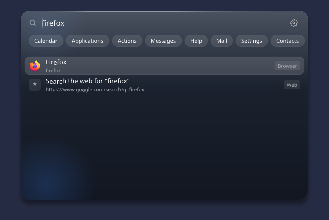
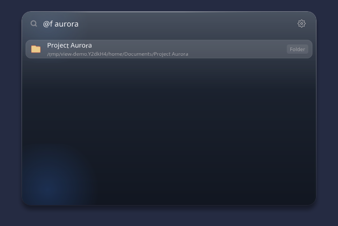
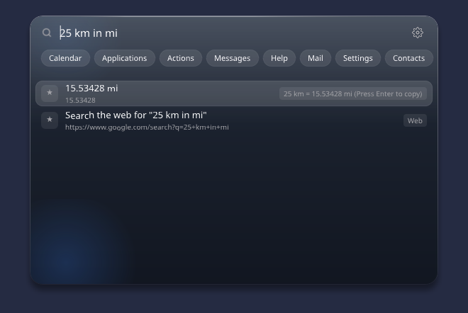
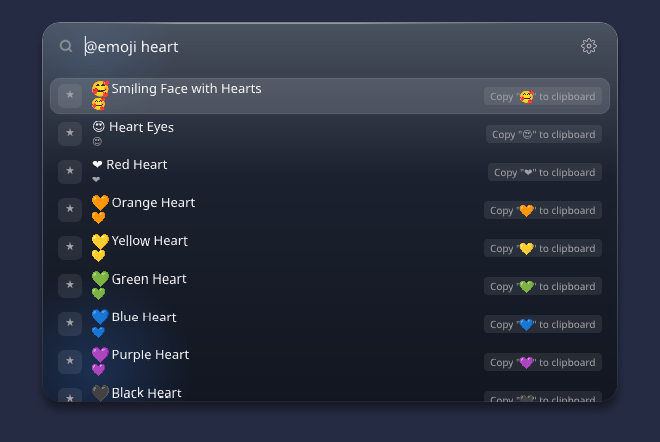
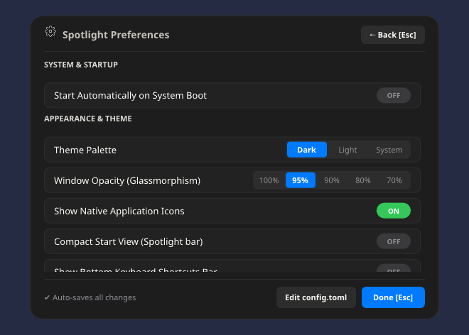

# view-launcher

A lightweight, high-performance desktop application and file launcher for Linux and Windows, written in Rust and powered by Slint with hardware-accelerated OpenGL rendering.

---

## Overview

`view-launcher` provides an instant search overlay for applications, local files, folders, and inline mathematical calculations. It is designed to replace heavy desktop application menus with an immediate, keyboard-driven interface.

---

## Features

- **Sub-millisecond startup**: Zero-cost abstraction in Rust with pre-indexed application caches and O(1) icon lookups.
- **Application Search**: Automatic indexing of system `.desktop` entries on Linux and Start Menu shortcuts (`.lnk`) on Windows.
- **Dedicated File Search Mode (`@f`)**: Prefix queries with `@f` to perform fast multi-threaded file and folder searches.
- **Interactive Directory Navigation**: Press `Tab` on any folder result to browse into that folder directly within the search bar.
- **Inline Calculator & Unit Evaluation**: Direct evaluation of arithmetic expressions (`500 * 12`), hexadecimal (`0xFF`), and binary (`0b1010`) with automatic clipboard copy on `Enter`.
- **Vietnamese Accent Normalization**: Matches unaccented input against accented filenames and application names (e.g. `tai lieu` matches `Tài liệu`).
- **Hardware-Accelerated UI**: Rendered via Slint and OpenGL (FemtoVG) for per-pixel transparency, antialiased rounded corners, and native HiDPI scaling.
- **In-App Preferences Panel (`Ctrl + ,`)**: Graphical settings menu to configure native icons, shortcut hints, path matching, visible result limits, and system autostart.
- **Single-Instance Daemon**: Uses Unix domain sockets on Linux and local TCP loopback on Windows to toggle the active window in less than 5ms.

---

## Screenshots

| Application search | File and folder search |
| --- | --- |
|  |  |

| Calculator and unit conversion | Emoji picker |
| --- | --- |
|  |  |

### Spotlight Preferences



## Installation

### Linux (Ubuntu / Debian)

Download the `.deb` package from [GitHub Releases](https://github.com/hieunx1024/view-launcher/releases/latest):

```bash
sudo dpkg -i view-launcher_0.5.1_amd64.deb
```

The package installs the desktop entry and system icons. The default launcher shortcut is `Ctrl + Alt + Space`.

### Windows

1. Download `view-launcher-setup.exe` from GitHub Releases.
2. Run the installer to install the application, add it to your user `PATH`, and register the global shortcut.
3. Alternatively, download the portable `view-launcher-windows-x86_64.zip` archive and run `view-launcher.exe` directly.

---

## Building from Source

### Prerequisites

- **Rust**: Rust 1.80+ (Edition 2024 or 2021)
- **Linux Build Dependencies**:
  ```bash
  sudo apt-get install -y libxkbcommon-dev libfontconfig1-dev libwayland-dev libegl1-mesa-dev libgl1-mesa-dev libx11-dev
  ```

### Build Commands

```bash
# Clone the repository
git clone https://github.com/hieunx1024/view-launcher.git
cd view-launcher

# Run tests
cargo test

# Build optimized release binary
cargo build --release
```

The compiled binary will be located at `target/release/view-launcher` (or `target/release/view-launcher.exe` on Windows).

---

## Keyboard Shortcuts

| Shortcut | Context | Action |
| :--- | :--- | :--- |
| `Ctrl + Alt + Space` | Global Desktop | Toggle launcher window |
| `Down` / `Up` | Search List | Navigate through search results |
| `Enter` | Search List | Launch selected application, open file, or copy calculation |
| `Tab` | File Search Mode | Enter selected directory in search path |
| `Backspace` | Search Bar | Delete character; if at root of directory, moves to parent |
| `Alt + T` | Search List | Open containing directory in terminal |
| `Alt + C` | Search List | Copy file path or calculation result to clipboard |
| `Ctrl + ,` | Main Window | Open in-app preferences panel |
| `Esc` | Main Window | Close settings panel or hide launcher window |

---

## Configuration

Configuration is saved in standard platform directories:
- **Linux**: `~/.config/view-launcher/config.toml`
- **Windows**: `%APPDATA%\view-launcher\config.toml`

### Example `config.toml`

```toml
[general]
autostart = false

[theme]
view_style = "liquid_glass" # "liquid_glass" (Spotlight Tahoe) or "classic"
query_color = "#7aa2f7"
selection_bg = "#262f4d"
selection_fg = "#ffffff"
border_color = "#3d59a1"
highlight_color = "#7dcfff"
show_icons = true
show_status_bar = false

[search]
max_results = 7
max_depth = 2
enable_path_matching = true
ignored_dirs = [".git", "node_modules", "target", "build", ".venv", "dist"]
ignored_extensions = [".tmp", ".o", ".lock", ".log"]

[[search.paths]]
path = "~"
depth = 2

[[search.paths]]
path = "~/Projects"
depth = 3

[apps]
pinned = ["Firefox", "Visual Studio Code", "Terminal"]
hidden = ["Help", "Software Updater"]
extra_desktop_paths = []
```

---

## Spotlight "Liquid Glass" (macOS Tahoe Look) & Compositor Blur

View Launcher features an ultra-responsive, photorealistic **Liquid Glass** view style modeled after macOS Spotlight Tahoe, with runtime blur detection across 4 tiers:

### 1. Compositor Blur Setup

#### Hyprland (Tier 3)
Add these rules to `~/.config/hypr/hyprland.conf`:
```ini
windowrulev2 = blur, class:^(view-launcher)$
windowrulev2 = ignorealpha 0.2, class:^(view-launcher)$
windowrulev2 = float, class:^(view-launcher)$
windowrulev2 = center, class:^(view-launcher)$
windowrulev2 = noshadow, class:^(view-launcher)$
```

#### SwayFX (Tier 3)
Add to `~/.config/sway/config`:
```ini
for_window [app_id="view-launcher"] blur enable, floating enable
```

#### KDE Plasma (X11 & Wayland)
- **X11 (Tier 1)**: Native `_KDE_NET_WM_BLUR_BEHIND_REGION` atom set dynamically on the visible panel geometry, animating smoothly at 60Hz.
- **Wayland (Tier 2)**: Automatic binding via `ext-background-effect-v1` or `org_kde_kwin_blur_manager`.

#### GNOME / Mutter (Tier 4 Fallback)
Automatic graceful fallback: raises tint opacity to 90% (light) / 93% (dark) with enhanced specular rim and bloom highlights for a clean glass aesthetic without compositor blur.

### 2. Tunable Visual Knobs

All design tokens are centralized in [`ui/theme.slint`](ui/theme.slint):
- `pill_width` (470px) / `pill_height` (40px) / `pill_radius` (20px)
- `panel_width` (576px) / `panel_radius` (18px) / `shadow_margin` (18px)
- `anim_open` (180ms) / `anim_expand` (220ms) / `anim_row_slide` (120ms)
- `pill_tint` / `panel_tint` (multi-stop RGBA gradients for blur & fallback modes)
- `bloom_bottom_left` (`#7CC4FF@28%`) & `bloom_top_left` (`#FFE9B0@18%`)
- `chip_height` (24px) / `chip_radius` (12px) / `row_height` (36px)

---

## License

This project is licensed under the MIT License. See [LICENSE](LICENSE) for details.
